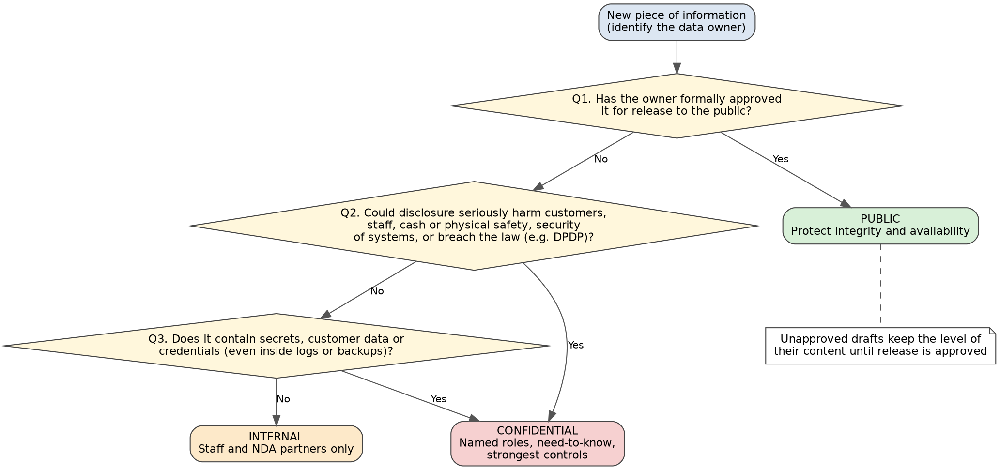

**Intern:** ISHAAN BANSAL | **Intern ID:** 2436 | **Organisation:** RedKross Research Foundation | **Batch:** October 2026\
**Repository:** https://github.com/Gitishaan1/redkross-data-handling-guide *(update if the repository name differs)*\
**Date:** October 2026

---

## Abstract

Organisations protect information unevenly unless they first decide which information matters most and what each kind of information requires. This report documents the design of a **three-level data classification and handling guide** (Public, Internal, Confidential) for a fictional bank, **KLP BANKS**. The work consists of a classification register of 17 data types, a handling matrix covering six rule areas (storage, sharing, access, retention, disposal, incident reporting) for each level, eight practical security scenarios, and a one-page staff checklist. The design is grounded in ISO/IEC 27001:2022 and 27002:2022, NIST SP 800-88 Rev. 2, the FIPS 199 impact-based approach, India's Digital Personal Data Protection (DPDP) Act 2023 and Rules 2025, the CERT-In Directions of April 2022 and RBI cyber security requirements for banks. The method is desk research and policy design; **no software was built and no technical testing against live systems was performed**. The report is explicit about limitations, especially where numeric values are design choices and where legal details must be verified against primary texts before real use.

---

## 1. Introduction and objective

### 1.1 Task statement

The assigned task (Intern ID 2436, topic *Data Handling*) was to create a classification and handling guide for **public, internal and confidential** information, defining **storage, sharing, access, retention, disposal and incident reporting** rules for each level, with a classification matrix, practical examples and a one-page staff checklist.

### 1.2 Why it matters for cybersecurity

A classification scheme is a security control in its own right. It answers the question "how much protection does this data need?" so that effort and cost go where the risk is. Without it, organisations either over-protect everything (wasting effort and encouraging staff to bypass controls) or under-protect the data that attackers actually want. Many real incident types, such as misdirected email, data copied to personal accounts, secrets written to logs, stale data stolen in ransomware attacks and unsanitised devices sold on, are failures of data handling rather than failures of any single technology. A clear guide, tied to specific threats, gives staff rules they can follow and auditors rules they can check.

### 1.3 Scope and approach

The guide is written for a fictional Indian bank so that the rules can be tested against realistic assets (customer records, cash positions, lockers, credentials) and against the legal environment that a bank in India faces. The deliberate focus is on **threats**: each rule is linked to the attack or failure it is meant to stop.

### 1.4 Objectives

1. Define three classification levels and a repeatable method for assigning data to them.
2. Classify a realistic set of bank data types and justify each decision in terms of attacker behaviour and harm.
3. Define rules for six handling areas at each level, aligned with recognised standards and Indian regulation.
4. Show the rules working through practical, security-focused scenarios.
5. Provide a one-page checklist that non-specialist staff can use.

---

## 2. Background research

Research consisted of reading and summarising standards, regulations and technical guidance. Primary documents were used wherever they were freely available. Where the primary text is paywalled or was not read in full, secondary explanations were used for orientation only and are labelled as such in the references.

### 2.1 ISO/IEC 27001:2022 Annex A and ISO/IEC 27002:2022

ISO/IEC 27001 specifies an information security management system, and its Annex A lists controls, while ISO/IEC 27002 provides the implementation guidance. Controls relevant to this task are:

| Control | Title | Relevance |
|---|---|---|
| A.5.12 | Classification of information | Defines levels and who is accountable for them; guidance warns against both over- and under-classification |
| A.5.13 | Labelling of information | Labelling follows the classification scheme; labels can have side effects (a "Confidential" label also tells an attacker which files to steal first) |
| A.5.14 | Information transfer | Rules, procedures and agreements for moving information by electronic, physical and verbal means, matched to classification |
| A.5.15 and A.8.3 | Access control; Information access restriction | Access rules (5.15) enforced technically (8.3); least privilege and need to know |
| A.8.10 | Information deletion | New in the 2022 edition; deletion must follow defined rules and be demonstrable |

### 2.2 NIST SP 800-88 Rev. 2: Guidelines for Media Sanitization

NIST SP 800-88 Revision 2 was published in September 2025 and supersedes Revision 1 (2014). Its emphasis moved from individual sanitisation decisions to an **organisation-wide sanitisation programme** with defined roles and records. It describes three sanitisation outcomes:

- **Clear:** logical techniques that protect against simple, non-invasive recovery using ordinary tools.
- **Purge:** techniques that protect against laboratory-level recovery, for example cryptographic erase or block erase.
- **Destroy:** physical destruction of the media so that it cannot be used.

**Cryptographic erase** deserves a note: data is kept encrypted, and sanitisation destroys the encryption key so the data becomes unreadable. It is a form of *encryption* use, not hashing, and it matters for cloud storage where physical destruction is not possible. Secondary sources report that Revision 2 discourages the older multi-pass overwrite practice on modern drives; this should be confirmed in the primary document before it is relied upon.

### 2.3 FIPS 199 and NIST SP 800-60

FIPS 199 defines low, moderate and high impact levels for the effect of losing confidentiality, integrity or availability, and SP 800-60 maps types of information to those impact levels. The report borrows the **impact-of-harm reasoning**, not the exact categories: the level assigned to data depends on how bad the consequences of compromise would be.

### 2.4 India's DPDP Act 2023 and DPDP Rules 2025

The Digital Personal Data Protection Act, 2023 sets duties for handling personal data. The DPDP Rules, 2025 were notified on 13 November 2025 and published in the Gazette on 14 November 2025, with a **phased commencement**; the core obligations (including breach and security duties) are reported to apply from mid-May 2027 (sources differ by a day, so the Gazette text should be checked). Points used in this guide:

- A personal-data breach must be reported to the **Data Protection Board within 72 hours** of the organisation becoming aware, with affected individuals informed **without delay**.
- Personal data must be erased once its purpose is served, **unless a law requires it to be kept**.
- Logs and associated personal data must be retained for **at least one year** to support breach detection and investigation.

A deliberate tension follows: deletion duties push towards keeping less, while logging duties push towards keeping some data for a year. The guide resolves this by distinguishing personal records (delete when the purpose ends) from security logs (keep for a defined period).

### 2.5 CERT-In Directions, 28 April 2022

CERT-In's directions under section 70B(6) of the IT Act, 2000 require service providers, intermediaries, data centres, body corporates and government organisations to report listed cyber incidents to CERT-In **within six hours** of noticing them or being told of them. The list of reportable incidents is broad and includes, for example, attacks on critical systems, data breaches and the existence of fake mobile apps impersonating an organisation. Secondary sources also report a 180-day log-retention requirement within Indian jurisdiction; the primary text should be checked.

### 2.6 RBI requirements for banks

RBI's *Cyber Security Framework in Banks* (2016) and *Master Direction on IT Governance, Risk, Controls and Assurance Practices* (issued November 2023, effective 1 April 2024) set cyber security governance and incident-response expectations for banks. Secondary sources report a 2 to 6 hour incident-reporting window to RBI and a log-retention period of at least two years under the 2016 framework. **These two figures were not verified against RBI's own text** and are labelled accordingly wherever they appear.

### 2.7 Logging hygiene: CWE-532

MITRE's CWE-532 describes the weakness of writing sensitive information (credentials, personal data) into log files. This weakness motivated the guide's rule that systems must never write secrets into logs, with Confidential classification of logs as a secondary safeguard.

### 2.8 Key takeaways that shaped the design

1. Classification is only useful if each level has **different, specific, checkable** handling rules.
2. Over-classifying everything weakens the scheme.
3. Disposal is a *programme* with evidence, not an act.
4. Regulation attaches **clocks** (6 hours, 72 hours, one year) that internal reporting rules must be designed around.
5. Public data still needs integrity and availability protection.

---

## 3. Methodology

The work was done in six steps.

1. **Research.** Read and summarised the sources in Section 2; noted control numbers, definitions and legal timelines; separated primary sources from secondary explanations.
2. **Scenario definition.** Chose a fictional bank (KLP BANKS) and listed the data it would hold, including security-specific data (credentials, security reports, logs) that a cybersecurity reviewer would expect.
3. **Threat-based classification.** For every data type, followed the chain *data → what an attacker wants and can do → who is harmed and how → level*. The decision flow is shown in Figure 1.
4. **Rule design.** For each level and each of the six rule areas, wrote "must / must not" statements, each linked to a threat. Confidential rules were written first; Internal and Public rules were derived by relaxing them step by step, asking each time what risk is being accepted.
5. **Scenario walkthroughs.** Wrote eight scenarios and checked, on paper, which rules apply, which are broken, and which controls would have prevented the problem.
6. **Consolidation.** Condensed the matrix into a one-page checklist, built a threat-to-rule traceability table (Section 6) and recorded limitations.

*Figure 1: Classification decision flow used for the register.*

---

## 4. Tools and technologies

This was a document-and-policy project. Tools used:

| Tool | Purpose |
|---|---|
| Public standards, regulatory texts and technical guidance | Research (Section 2) |
| Markdown and Git/GitHub | Writing, version control and publication of the deliverables |
| Graphviz | Drawing the classification decision flow |
| Pandoc and a PDF renderer | Producing the PDF versions of the report and checklist |
| AI writing assistance | See Section 11 for a disclosure |

No attack tools, scanners or live systems were used. No security testing was performed.

---

## 5. Work performed

### 5.1 Classification levels

| Level | Definition |
|---|---|
| Public | Formally approved for release. Risk is tampering and unavailability, not secrecy |
| Internal | For staff and partners under NDA. Disclosure causes limited, recoverable harm |
| Confidential | Disclosure could seriously harm customers, staff, cash or physical safety, system security, or breach the law |

### 5.2 Classification register

Seventeen data types were classified: **10 Confidential, 3 Internal, 4 Public**. The full register with attacker goals and harm analysis is in `deliverables/01_classification_register.md`. Notable decisions:

- **Classify by content, not container.** The blank cheque form is Public; the customer-to-cheque-book mapping is Confidential.
- **Time-dependent classification.** Interest rates are Confidential until announced, then Public. The data owner approves the change.
- **Logs are Confidential.** They give attackers reconnaissance, they are evidence whose integrity matters, and they may contain staff activity data. They are restricted to authorised administrators and security staff, and a separate rule forbids writing secrets into logs.
- **Security-specific data was added** (credentials and keys; security architecture and VAPT reports), because these are what attackers target and what a cybersecurity guide must cover.
- **Former records and logs were separated** because their retention logic differs.
- **Funding agreements are Internal as a judgement call**, with the alternative argument documented.

### 5.3 Handling matrix

The full matrix is in `deliverables/02_handling_matrix.md`. Examples of design decisions and their reasons:

| Decision | Reason |
|---|---|
| Encryption keys held in key management with **dual control**, not by "a few people at the top" | Seniority is not need to know; a single key holder is a single point of compromise and failure |
| Backups allowed but restricted | Eliminating copies entirely trades confidentiality risk for availability risk (ransomware, disk failure) |
| Access reviews, expiry for temporary access, MFA | Counters privilege creep and stolen credentials |
| Administrators not sole reviewers of their own logs | Segregation of duties; prevents covering of tracks |
| Retention owned by the data owner and aligned to law, with a 30-day disposal trigger ◆ | Deletion is a duty and over-retention enlarges breaches |
| Confidential disposal requires **purge or destroy**, with evidence and third-party certificates | Clear alone does not defend against laboratory recovery; ISO A.8.10 expects demonstrable deletion |
| Internal reporting deadline of 1 hour ◆ for Confidential incidents | The bank must be able to meet 6-hour (CERT-In) and 72-hour (DPDP) clocks; staff delay uses up the budget |
| No-blame reporting | Fear of punishment delays reports, which is more damaging than the original mistake |
| Public level restricts **editing**, not reading | Integrity attacks on published information (altered rates, phone numbers) enable fraud |

### 5.4 Practical examples

Eight scenarios (`deliverables/03_practical_examples.md`) walk through situations such as customer data sent to personal email, a phishing click followed by a late report, secrets written to debug logs, resold laptops, a misdirected statement, an altered website and fake app, a lingering contractor account, and stale KYC files lost in a ransomware attack. Each scenario names the level, the broken rules, the attacker's opportunity, the correct response and the preventive controls.

### 5.5 Staff checklist

A one-page checklist (`deliverables/04_staff_checklist.md`, also supplied as PDF) condenses the guide into a "know the level, tick before you act, report fast" form with seven golden rules.

---

## 6. Findings and results

### 6.1 Threat-to-rule traceability

The design objective was that every rule should address a named threat. The table below shows the main threats and where the guide responds.

| Threat | Main rule areas (levels) |
|---|---|
| Phishing and stolen credentials | Access (MFA, least privilege); Incident reporting (fast, no blame) |
| Insider snooping or misuse | Access (need to know, reviews, logging, segregation of duties) |
| Misdirected email and oversharing | Sharing (named recipients, verification, approved channels) |
| Data exfiltration to personal accounts or devices | Storage and Sharing (approved systems only, no personal accounts) |
| Ransomware and backup theft | Storage (minimum copies, protected backups); Retention (less stale data) |
| Lost or stolen devices and media | Storage (encryption); Disposal (sanitise before reuse) |
| Recovery of data from discarded media | Disposal (purge or destroy, evidence, third-party certificates) |
| Secrets exposed through logs | Classification of logs; the rule against writing secrets into logs; Access |
| Over-retention enlarging a breach | Retention (owner-run schedule, 30-day disposal trigger) |
| Tampering with published content; impersonation | Public: Access (edit control), Storage (protected master), Incident reporting |
| Delayed breach response and missed legal clocks | Incident reporting (1-hour internal deadline, escalation to CERT-In 6 hours, DPDP 72 hours) |

### 6.2 Findings from the design process

1. **The levels differ mainly in audience, strength of protection and amount of proof kept**, not in whether any protection exists. A common baseline applies at all levels.
2. **Relaxing a rule rarely means removing it.** For example, removable media at Internal level became "bank-issued and encrypted only", not "allowed".
3. **Public data needs a security design too.** Its main risks are integrity and availability.
4. **Legal clocks drive internal rules.** Regulators' deadlines of 6 hours (CERT-In), 2 to 6 hours (RBI, as reported by secondary sources) and 72 hours (DPDP) leave little time, so internal reporting must be fast and blame-free.
5. **Retention and deletion pull in opposite directions** and need an explicit, owner-run schedule, with separate treatment for personal records and security logs.
6. **Classification alone is not enough.** The scenarios show that labelling data does not help unless handling rules, technical enforcement and a reporting culture exist.

### 6.3 Results (deliverables)

| Deliverable | Location |
|---|---|
| Classification register (17 data types) | `deliverables/01_classification_register.md` |
| Handling matrix (3 levels × 6 rule areas) | `deliverables/02_handling_matrix.md` |
| Practical examples (8 scenarios) | `deliverables/03_practical_examples.md` |
| One-page staff checklist | `deliverables/04_staff_checklist.md` and `.pdf` |
| Decision-flow diagram | `diagrams/classification_decision_flow.png` |

---

## 7. Testing and evaluation

**No technical testing was performed.** This project designs a policy and does not implement software or controls, so there were no systems to test, scan or attack. Evaluation was limited to the following desk-based checks:

1. **Traceability check.** Every Confidential rule area was checked against the threat table in Section 6.1, confirming that each rule maps to at least one named threat and each listed threat has at least one rule.
2. **Scenario walkthroughs.** Eight scenarios were analysed on paper against the matrix to confirm that the rules are specific enough to say what should have happened and who should have acted.
3. **Internal consistency check.** Rules were checked for contradictions across levels (for example, each level is no weaker than the one below it in audience restriction), and regulatory timelines were checked against the internal reporting deadlines.

These checks show that the guide is internally coherent. They do **not** show that it would work in a real bank. That would require a pilot with real staff, tabletop exercises, audits and measurement (for example, report times and policy-violation rates).

---

## 8. Limitations

1. **Fictional organisation.** KLP BANKS has no real systems, regulators' supervision, staff or risk assessment; rules were designed from reasoning, not from an actual risk assessment.
2. **No testing.** See Section 7. The effectiveness of the guide is not measured.
3. **Design-choice values.** Items marked ◆ (1-hour and 24-hour reporting deadlines, quarterly and annual review intervals, 30-day disposal trigger, two-year log retention) are author's choices, not legal requirements.
4. **Legal details not verified in primary text.** The RBI incident-reporting window, the RBI and CERT-In log-retention periods, the exact DPDP commencement date, and banking record-retention rules (KYC and anti-money-laundering) were taken from secondary sources or are unresolved. Aadhaar handling and RBI locker rules were not researched in detail. These must be checked against official texts before real use.
5. **Standards read through secondary summaries.** The full text of ISO/IEC 27001 and 27002 is paywalled; the controls were understood from public summaries and the standards' titles. A real implementation should work from the standards themselves.
6. **Three levels only.** The task fixes three levels. A real bank may need finer sub-levels (for example, a restricted tier for cryptographic keys) and records of regulatory categories such as payment card data.
7. **Not legal advice.** The guide describes good security practice and does not constitute legal advice or a compliance statement.
8. **Static document.** Threats, laws and standards change; the guide needs scheduled review.

---

## 9. Recommendations

For an organisation adopting a guide like this:

1. **Appoint data owners** for every data type, with authority to classify, approve access and approve disposal.
2. **Build a data inventory** so that nothing sits on a forgotten server (Scenario 8).
3. **Enforce rules with technology**: data-loss-prevention rules, MFA, central key management, expiring contractor accounts and log masking, instead of relying only on staff memory.
4. **Run a sanitisation programme** in line with NIST SP 800-88 Rev. 2, with an asset register and certificates from third parties.
5. **Practise incident reporting** with drills against the 1-hour, 6-hour and 72-hour clocks, and reinforce a no-blame culture.
6. **Verify the legal basis** of every retention and reporting figure against primary texts with legal and compliance specialists.
7. **Train staff** with the checklist and scenarios, and review the guide at least annually.
8. **Measure effectiveness**, for example time to report, access-review completion rates and number of misdirected-data incidents.

Future work for this project could include a tabletop exercise built from the scenarios, a mapping of the guide to a full control framework, and an automated check for secrets in logs.

---

## 10. Conclusion

This report presented a threat-driven data classification and handling guide for a fictional bank. It defined three levels, classified seventeen data types with explicit attacker-and-harm reasoning, set rules for six handling areas at each level, and showed the rules in use through eight scenarios and a one-page checklist. The guide's main message is that data handling is a security control: the right level of protection depends on what an attacker could do with the data and whom that would hurt, and the rules must be specific, enforceable and fast enough to meet legal reporting deadlines. The work is a design exercise with documented limitations. Its numeric values are design choices, several legal details need verification against primary sources, and it has not been tested in practice.

---

## 11. Declaration on the use of AI assistance

An AI assistant (Claude, by Anthropic) was used during this project to explain concepts, review drafts, help locate sources and help draft the written deliverables, including this report. The intern directed the project, chose the fictional organisation and the data types, drafted and revised the Confidential-level rules, and is responsible for the submission. Every source cited was identified through searches and should be read in its original form by anyone relying on this report. *(If RedKross has a policy on AI tools, follow it and adjust this paragraph so that it is accurate.)*

---

## 12. References

References follow IEEE style. Items marked † were consulted through secondary summaries or not read in full and should be verified against the primary text.

**Primary and standard sources**

[1] ISO/IEC, *Information security, cybersecurity and privacy protection: Information security management systems: Requirements*, ISO/IEC 27001:2022, International Organization for Standardization, Geneva, Switzerland, 2022. †

[2] ISO/IEC, *Information security, cybersecurity and privacy protection: Information security controls*, ISO/IEC 27002:2022, International Organization for Standardization, Geneva, Switzerland, 2022. †

[3] National Institute of Standards and Technology, "Guidelines for Media Sanitization," NIST Special Publication 800-88 Rev. 2, Sep. 2025. [Online]. Available: https://csrc.nist.gov/pubs/sp/800/88/r2/final *(add the authors listed on the NIST page)*

[4] National Institute of Standards and Technology, "Standards for Security Categorization of Federal Information and Information Systems," FIPS PUB 199, Feb. 2004. †

[5] National Institute of Standards and Technology, "Guide for Mapping Types of Information and Information Systems to Security Categories," NIST SP 800-60 Vol. 1 Rev. 1, Aug. 2008. †

[6] Government of India, *The Digital Personal Data Protection Act, 2023* (Act No. 22 of 2023). [Online]. Available: https://www.meity.gov.in/static/uploads/2024/06/2bf1f0e9f04e6fb4f8fef35e82c42aa5.pdf

[7] Ministry of Electronics and Information Technology, Government of India, *Digital Personal Data Protection Rules, 2025*, notified Nov. 2025. [Online]. Available: https://www.meity.gov.in/static/uploads/2025/11/53450e6e5dc0bfa85ebd78686cadad39.pdf †

[8] Indian Computer Emergency Response Team (CERT-In), "Directions under sub-section (6) of section 70B of the Information Technology Act, 2000 relating to information security practices, procedure, prevention, response and reporting of cyber incidents for Safe & Trusted Internet," No. 20(3)/2022-CERT-In, Apr. 28, 2022. [Online]. Available: https://www.cert-in.org.in/PDF/CERT-In_Directions_70B_28.04.2022.pdf

[9] Reserve Bank of India, *Cyber Security Framework in Banks*, 2016. [Online]. Available: https://m.rbi.org.in/CommonPerson/English/Scripts/Notification.aspx?Id=1721 †

[10] Reserve Bank of India, *Master Direction on Information Technology Governance, Risk, Controls and Assurance Practices*, Nov. 2023 (effective Apr. 1, 2024). [Online]. Available: https://www.rbi.org.in †

[11] MITRE, "CWE-532: Insertion of Sensitive Information into Log File," Common Weakness Enumeration. [Online]. Available: https://cwe.mitre.org/data/definitions/532.html †

**Secondary sources used for orientation only**

[12] isms.online, "ISO 27001 Annex A 5.12, 5.13, 5.14, 8.3 and 8.10 explanations," 2025–2026. [Online]. Available: https://www.isms.online/iso-27001/ *(access dates to be added)*

[13] UpGuard, "ISO 27001 Control 5.14: Information transfer" and "Control 8.3: Information access restriction." [Online]. Available: https://www.upguard.com/compliance/iso-27001/

[14] Trilegal, "2022 CERT-In Directions on Reporting Cyber Incidents," May 4, 2022. [Online]. Available: https://trilegal.com/knowledge-repository/2022-cert-in-directions-on-reporting-cyber-incidents/

[15] SCC Online, "Digital Personal Data Protection Rules 2025: Key highlights," Dec. 26, 2025. [Online]. Available: https://www.scconline.com/blog/post/2025/12/26/digital-personal-data-protection-rules-2025-key-highlights/

[16] Ogma, "CERT-In Compliance Checklist for Banks and Financial Institutions in India." [Online]. Available: https://ogma.in/blog/cert-in-compliance-checklist-for-banks-and-financial-institutions-in-india

*Note on references:* Before submission, open each link, add access dates, and replace secondary sources with primary texts wherever possible.
